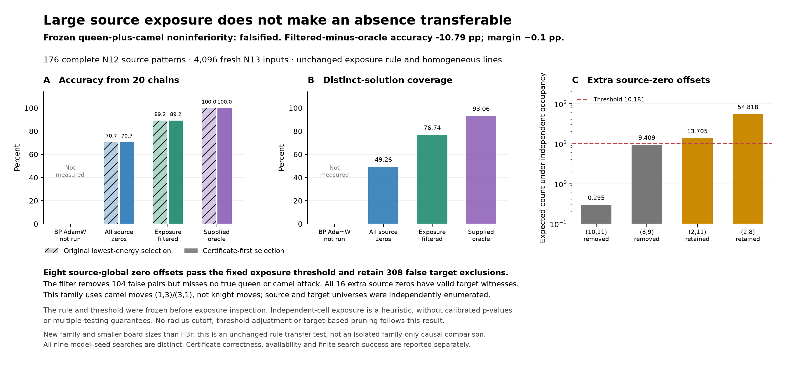

# H3t: unchanged exposure filter on queen-plus-camel transfer

The frozen noninferiority hypothesis is **falsified**: filtered N20 accuracy is **89.208984%** versus **100%** for the supplied oracle. The difference is **−10.791016 percentage points**, with paired-input bootstrap one-sided 95% endpoints **[−11.572266, −10.034180]**. All arms have zero wrong stops.

The filter improves over the unfiltered hybrid's 70.654297% accuracy, but retains eight complete-source absences causing 308 false target exclusions. Some retained extras have exposure 54.818, well above the unchanged 10.181 threshold. Independent-cell exposure remains a heuristic, without calibrated p-values or coverage guarantees.

The source contains all 176 unique N12 queen-plus-camel solutions; evaluation uses 4,096 fresh N13 inputs and three search seeds. Both family and board sizes differ from H3r, so this does not isolate a family-only effect. All nine searches are distinct; 737,280 saved boards passed audit.

[Full report](../../../../research/20261114/loki/h3t/REPORT.md), [frozen protocol](../../../../research/20261114/loki/h3t/protocol.json), [summary](summary.json), [per-seed counts](per_seed.csv), [all source exposures](source_offset_exposures.csv), [removed offsets](removed_zero_offsets.csv), [SVG figure](camel-family.svg), [figure provenance](plot-provenance.json).
