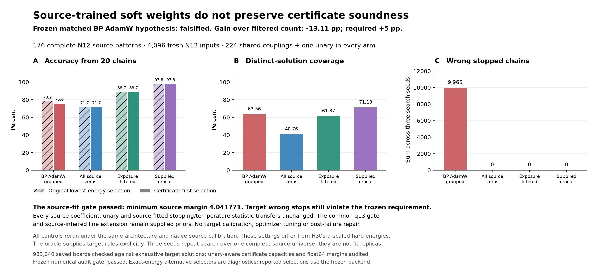

# H3u: matched grouped BP AdamW transfer

The frozen hypothesis is **falsified**. BP AdamW certificate-first accuracy is **75.634766%**, versus **88.745117%** for filtered counts: **−13.110352 percentage points**, with paired-input one-sided 95% endpoints **[−14.144287, −12.117513]**. It also produces **9,965 incorrect stopped chains**.

All wrong stops satisfy the learned margin in float64 and have exactly 13 queens. Their violations are diagonal or camel conflicts, despite a successful source-fit gate. Original lowest-energy selection reaches 78.181966%; certificate-first selection makes this soft model worse.

Every arm uses the same 224-coupling-plus-unary architecture, unchanged source weights and native source-only calibration. These conditions differ from H3t's q-scaled hard energies. All 12 searches are distinct; 983,040 boards passed the independent audit and numerical diagnostic gate.

[Full report](../../../../research/20261114/loki/h3u/REPORT.md), [protocol](../../../../research/20261114/loki/h3u/protocol.json), [summary](summary.json), [per-seed counts](per_seed.csv), [source weights](source_offset_weights.csv), [false-stop mechanism](false-stop-mechanism.json), [SVG](soft-transfer.svg), [figure provenance](plot-provenance.json), [prelaunch correction](../../../../research/20261114/loki/h3u/PRELAUNCH_AMENDMENT.md).
