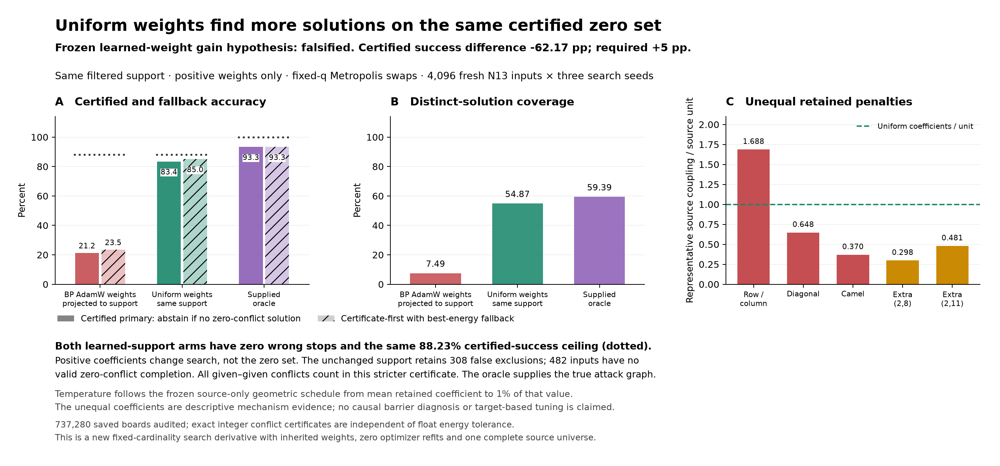

# H3v: positive weights on a fixed certified zero set

The frozen search-benefit hypothesis is **falsified**. Inherited positive BP AdamW weights reach **21.248372%** certified success from 20 chains, versus **83.414714%** with uniform weights on the same support. The paired difference is **−62.166341 points**, with one-sided 95% endpoints **[−63.069661, −61.287435]**. Every arm has zero wrong stops.

Both supports admit zero-conflict completions for exactly 3,614/4,096 inputs, an **88.232422% ceiling** for the abstaining certified primary. Positive weighting changes search but does not repair the 308 retained false exclusions. Original and certificate-first fallback accuracy are reported separately.

This is a new fixed-q Metropolis-swap derivative with a frozen source-only temperature schedule, inherited weights and no refit. All 737,280 saved states passed the q, givens and exact conflict-count audit.

[Full report](../../../../research/20261114/loki/h3v/REPORT.md), [protocol](../../../../research/20261114/loki/h3v/protocol.json), [summary](summary.json), [per-seed counts](per_seed.csv), [per-input zero-set capacities](per-input-capacity.npz), [audit-count validation](audit-count-validation.json), [SVG](fixed-support-search.svg), [figure provenance](plot-provenance.json).
