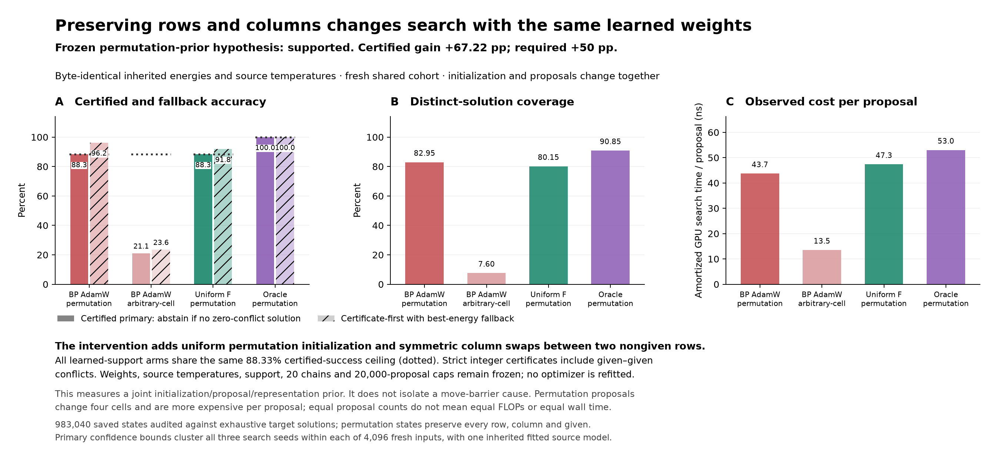

# H3w: permutation initialization and proposals

The frozen ≥50-point gain hypothesis is **supported**. With identical positive BP AdamW model bytes and source temperatures, permutation initialization and row-pair column swaps reach **88.305664%** certified success versus **21.085612%** for rerun arbitrary-cell search. The gain is **67.220052 points**, with one-sided 95% endpoints **[66.292318, 68.155924]**. All arms have zero wrong stops.

The intervention changes both initialization and proposals, adding the source-inferred row/column prior. It nearly reaches the unchanged support ceiling of **88.330078%**. It does not repair false exclusions or isolate a move-barrier cause. Permutation proposals cost more per move and more total measured search time than the arbitrary-cell control.

Learned-weight fallback accuracy is **96.215820%**, versus **91.829427%** for matched uniform permutation weights. These secondary fallback answers are not all certified under the learned support.

[Full report](../../../../research/20261114/loki/h3w/REPORT.md), [protocol](../../../../research/20261114/loki/h3w/protocol.json), [summary](summary.json), [per-seed counts](per_seed.csv), [per-input capacity](per-input-capacity.npz), [descriptive fallback comparisons](fallback-comparisons.json), [SVG](permutation-prior.svg), [figure provenance](plot-provenance.json).
